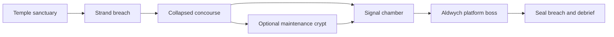

# Hellgate London The Hollow Line Game Plan

**Working game title:** Hellgate: London — The Hollow Line. **Status:** planning only, 11 October 2026. **Builder:** Sol 6.1. **Format:** an unofficial fan sequel with an original voxel implementation. The user chose a direct fan sequel, an implementation handoff for the next phase, and support for up to three players. Online co-op in separate browsers is the planning assumption.

Build a complete, replayable **10–12 minute, one to three player online co-op, third-person action RPG mission** for a desktop browser. Its purpose is to demonstrate three distinctive classes, readable and forceful combat, enemies that change player decisions, and loot that changes abilities. The finished build must have a working hosted URL, invite rooms, a beginning and ending, death and retry, and a reason to replay with another class. Playing alone uses a one-player online room; offline play is outside this slice.

The slice is **three classes, one route with one optional branch, four regular enemy archetypes, two elite modifiers, one two-phase boss, six legendary relics, and three weapon mods**. Every included class can finish the same mission solo, and duplicate classes are allowed in a party. A one-class combat prototype or a solo-only build is an intermediate milestone, not the finished deliverable. All balance values and performance figures below are initial targets to validate during implementation.

## The sequel idea

**London, 2048, in this fan continuity.** Ten years after the original setting, isolated Templar, Hunter, and Cabalist survivors have begun reclaiming the Underground. A demon called the Bellwether has learned to turn the sanctuary ward network into a transmission system. Its signal is opening small breaches inside supposedly safe territory. A joint expedition must follow the signal from Temple to a sealed platform beneath Aldwych and silence it.

The original game's London setting and its Templar, Hunter, and Cabalist class families supply the continuity. The year 2048, Hollow Line mission, characters, monsters, item names, and mechanics in this plan are new fan-authored material. They do not require recreating an existing campaign ending. The original manual documents the class families and their combat identities. [Hellgate London manual, printed pages 3–7](https://datassette.s3.us-west-004.backblazeb2.com/manuais/hellgate_london.pdf)

The sequel contribution is **a city that can be tactically broken apart**. Blades tear through barricades, rifle fire removes cover, and occult attacks shatter demon armor. Players recover corrupted relics and turn the enemy's power against it. London should feel wounded, dangerous, and inhabited: tiled stations, occult wards, broken brick terraces, rusting machinery, and distant bells.

Keep the brief to one skippable radio message: “Aldwych is transmitting through our wards. Follow the line. Silence whatever is ringing.” The last image is the platform lights returning while another distant bell answers. No cutscene production or dialogue tree is required.

## What players should feel

| Pillar | Visible evidence in the slice | Design constraint |
| --- | --- | --- |
| Class identity | A Blademaster dives into a crowd, a Marksman creates firing lanes, an Evoker groups enemies into an electrical kill zone | Different resources, attack shapes, movement decisions, sound, and silhouettes |
| Immediate action | Clear hit response, deliberate dodges, readable enemy commitments, satisfying deaths | Responsive controls and enemy tells precede additional content |
| Loot anticipation | The guaranteed relic changes the next encounter; a mod improves an existing tactic | Describe the behavior change before the numerical bonus |
| Hostile London | Street ruins give way to a corrupted Underground platform | One coherent environment kit with a few memorable landmarks |
| Voxel interaction | A breakable wall opens a flank and the boss visibly loses armor | Destruction changes a local combat choice without requiring a sandbox simulation |
| Small-party cooperation | One player groups enemies, another cuts through them, and a third removes a protected shooter | Shared enemy and world state, personal loot, no mandatory tank or healer |

The six familiar classes remain the larger sequel roster. The first slice includes one representative from each faction; companion AI and shield systems follow after this mission passes playtesting.

| Faction | Class | Slice status | Intended play identity |
| --- | --- | --- | --- |
| Templar | Blademaster | Playable | Dual blades, momentum, crowd cutting, aggressive repositioning |
| Hunter | Marksman | Playable | Precision fire, ammunition timing, weak points, grenades |
| Cabalist | Evoker | Playable | Focus management, chaining spells, pulling enemies together |
| Templar | Guardian | Later | Shield counters, drawing enemies close, defensive positioning |
| Hunter | Engineer | Later | One configurable drone, turrets, deployable firing lanes |
| Cabalist | Summoner | Later | One major demon and small elemental followers, command and sacrifice |

The future identities are design directions, not additional slice work. Do not present unimplemented classes as selectable buttons.

## The first playable mission

The geography is a compressed, fictional route using recognizable London place names, not a surveyed reconstruction. Target footprint: approximately 96 by 64 metres, divided into small encounter zones. Typical combat spaces are 14–22 metres wide; the boss arena is approximately 24 by 24 metres. Ceiling height and corner width must accommodate the camera.

| Elapsed target | Beat | Required experience | Reward or transition |
| --- | --- | --- | --- |
| 0:00–0:45 | Temple sanctuary | After room formation, select class, see controls, optionally hit a dummy, ready up and deploy through the ward | All three combat actions available immediately |
| 0:45–3:00 | Strand breach | First pack teaches movement and attack; second combines rushing enemies and shooters behind cover | First class-compatible Magic weapon by 90 seconds after deployment |
| 3:00–5:00 | Collapsed concourse | A Bulwark protects ranged enemies; break a marked wall to flank or fight through the front | Rare weapon plus a choice of the class's two Legendary relics |
| Optional additional 1:00–1:30 | Maintenance crypt | Short elite encounter behind the destructible shortcut | Choose one of three weapon mods; return to the main route |
| 5:00–7:30 | Signal chamber | A Cantor supports a mixed pack; use the chosen relic on enemies grouped around a transmitter | Guaranteed random weapon mod, then a full pre-boss resupply |
| 7:30–10:30 | Aldwych platform | Fight the Bellwether, remove its armor plates, respond to the second phase | One Rare equipment item and the unchosen class relic |
| 10:30–12:00 | Extraction | Seal the breach, see time, deaths, kills, and discovered relics | Replay same seed, roll new seed, or change class |

Target 10–12 minutes for a first successful main-route run and 11–14 with the optional branch, excluding waiting for friends to join. Learning, inventory use, and deaths can extend this. The boss target is 90–150 seconds at each supported party size. Only two or three objective words should compete with combat on screen, such as “Reach Aldwych” or “Silence the Bellwether.”

Use an authored layout. A seed varies approved encounter compositions, elite modifier selection, item rolls, and decorative debris. It does not alter critical paths, camera clearance, tutorial order, mandatory rewards, or the boss arena. Replay value initially comes from class and loot choices, not procedural maze generation.

## Camera and controls

Use a perspective camera over the right shoulder, approximately 4.5 metres behind and 2.2 metres above the player, with a configurable 70–90 degree vertical field of view. Default vertical FOV is 75 degrees. The player can look and aim with the mouse using pointer lock; WASD movement is relative to camera yaw. The avatar faces the aim direction during combat. Use camera collision so walls push the camera closer instead of hiding the player. There is one camera mode for the slice.

| Input | Action |
| --- | --- |
| WASD and mouse | Move and aim |
| Left mouse | Primary attack; holding repeats it |
| Right mouse | Class secondary action |
| Q | Class signature action |
| Space | Dodge in movement direction, or backwards if stationary |
| E | Interact, pick up, open a cache, seal the breach, hold to revive an ally |
| R | Reload Marksman weapon |
| H | Use a medkit |
| I | Inventory, equipment comparison, mod socket; pauses only a one-player room |
| Escape | Menu and release pointer lock; pauses only a one-player room |
| Middle mouse | Place a short-lived team ping at the aim point |

No jump, climbing, sprint, first-person mode, controller support, or touch controls in this release. Floors and ramps supply traversal. Menus support keyboard focus and mouse input. Provide sensitivity, invert Y, FOV, master/music/effects volume, reduced motion, and a quality preset. A mobile visitor sees an explanation that the game requires a desktop keyboard and mouse.

Input capture and audio begin after the player clicks Play. On tab blur, pointer-lock loss, inventory, or a menu, clear local held inputs. In a one-player room request an authoritative pause; in a co-op room the world continues and the avatar remains vulnerable. Label the co-op menu “World continues.” Return to play requires a click and must not fire the weapon. If pointer lock or WebGL 2 is unavailable, show a readable recovery message with a Retry control.

## Combat rules

The shared movement speed starts at 5 metres per second. Dodge travels 3.2 metres over 0.30 seconds, with 0.18 seconds of invulnerability from its start and a 2 second cooldown. Sweep movement against collision so dodges and lunges cannot cross walls. Two medkits each restore 45% maximum health; medkits have a 1 second use cooldown. The pre-boss checkpoint restores health, class resource or ammunition, and both medkits.

Damage resolves as `base damage × weapon multiplier × weak-point multiplier × armor multiplier × frontal multiplier × aura multiplier`. Armor multiplier is `100 / (100 + armor)`. A normal weak point multiplies eligible direct damage by 1.5; a Cantor's aura multiplier is 0.7. Ordinary damage never randomly misses. There are no random critical hits, elemental resistance tables, or damage-over-time stacking systems in the slice. Damage types primarily drive presentation and explicit item effects.

Projectiles and hitscan stop at solid cover. A ranged attack first finds the camera aim point, then checks the path from weapon muzzle to that point; the camera cannot let the player shoot around a wall. Melee uses a swept arc, a maximum range, and a line-of-sight check. A single swing or explosion hits each target once. Primary, secondary, signature, and reload actions are mutually exclusive; dodge can cancel them. Each attack has a short committed windup, active window, and recovery. Do not accept attack input while a modal menu has focus.

Use a shared server-owned hit pipeline and explicit source tags for direct attacks, mod effects, and relic effects. Only direct primary hits or kills can trigger mods. Secondary damage never recursively triggers another proc. Pool particles and damage numbers. Hit flashes, sparks or ash, stagger poses, audio, and small optional camera impulses communicate contact; avoid repeated full-screen flashes. Melee can hold the local weapon pose for up to 45 milliseconds but must not pause the shared simulation. Damage numbers are optional. Teammates never take friendly damage and do not block one another's movement or projectiles.

The first weak enemy should die in roughly 0.4–1.2 seconds of basic attacks; a normal ranged enemy should last 1–3 seconds. A Bulwark should punish frontal fire and become markedly faster to kill after a flank or guard break. Tune using measured encounters rather than matching every provisional number below.

## Playable class kits

These are new sequel kits built around familiar class identities. One primary weapon chassis per class keeps asset and balance work bounded. No skill tree or XP progression is necessary for the slice; the equipment and relic choices provide progression during the mission.

### Blademaster

The Blademaster earns Zeal by making contact, then spends it on wide attacks. Start with 130 health, 20 armor, and zero Zeal. Maximum Zeal is 100. After four seconds without dealing direct damage, Zeal decays at 10 per second. It does not regenerate passively.

| Action | Initial behavior | Purpose |
| --- | --- | --- |
| Twin Cut, left mouse | Three swings dealing 30, 30, and 45 damage; one swing every 0.35 seconds; 2.4 metre reach; 110 degree arc; combo resets after 1 second idle | Broad, reliable close combat; gain 10 Zeal per successful swing, once regardless of targets |
| Whirlwind, right mouse | Spend 40 Zeal; deal 65 damage once to enemies within 3 metres; 0.65 second action; 1 second cooldown | Reward gathering enemies and staying aggressive |
| Lunge, Q | Move up to 6 metres toward aim over 0.25 seconds; strike first contacted enemy for 45 damage; 5 second cooldown | Close on shooters or reach a flank; gain 15 Zeal if the strike connects |

Lunge has collision and no invulnerability. Whirlwind permits movement at half speed. Hold-to-repeat primary is sufficient; precise combo timing is not required. Broad melee collision and enemy recovery windows must make this class viable against the boss without unavoidable contact damage.

### Marksman

The Marksman rewards firing lanes, aim, and magazine timing. Start with 110 health and 10 armor. The pulse rifle holds 24 rounds, has unlimited reserve ammunition, and takes 1.2 seconds to reload. Auto-reload on an empty magazine; R also reloads. Reload can be cancelled by dodge, with no ammunition awarded until it finishes.

| Action | Initial behavior | Purpose |
| --- | --- | --- |
| Pulse Rifle, left mouse | Hitscan, 18 damage per round, 5 rounds per second, 30 metre range | Sustained precision; small recoil with quick recovery |
| Execution Round, right mouse | Hold for 0.6 seconds, then release to fire 80 damage using 4 rounds; movement at 60%; early release cancels without cost; no automatic repeat | Exposed weak points and deliberate target removal |
| Breach Grenade, Q | 75 damage within 3 metres, 0.7 second fuse, 8 second cooldown | Force clustered enemies out of cover and break barricades |

The grenade follows a simple ballistic arc, stops at its first collision, and has a clear landing marker. No bounce simulation or friendly fire. If Execution Round lacks four rounds, show a reload prompt instead of spending partial ammunition. No weapon swap, alternate gun chassis, or separate aim-down-sights camera is required.

### Evoker

The Evoker controls space and converts clusters into damage. Start with 95 health, 5 armor, and 100 Focus. Focus regenerates at 15 per second whenever Arc Lash is not channeling. Maximum Focus is 100. No ability spends health.

| Action | Initial behavior | Purpose |
| --- | --- | --- |
| Ember Focus, left mouse | Projectile dealing 24 damage at 3 shots per second, speed 24 metres per second, range 24 metres; no Focus cost | Resource-independent baseline attack |
| Arc Lash, right mouse | Channel at 4 ticks per second; 16 damage per tick to the aimed target within 12 metres; chains to at most two distinct enemies within 5 metres for 8 damage each; costs 20 Focus per second | Punish groups; all links require line of sight |
| Gravity Well, Q | Spend 40 Focus; place within 16 metres; 4 metre radius, 3 second duration, 8 second cooldown; pull light enemies toward the centre at up to 2 metres per second | Assemble a cluster and expose enemy positioning |

Gravity Well deals no base damage. Bulwarks move at 35% of the normal pull speed; the boss is immune to pulling. Pulling respects walls and never cancels an enemy's already committed attack. Arc Lash ends immediately if Focus runs out or line of sight is lost; fractional resource spending follows simulation time. Focus regeneration and cooldowns pause with the game.

## Enemies and counterplay

The following are newly designed demons for the fan sequel. Their names do not claim original-game canon. Use four distinct silhouettes and clear attack sounds before investing in cosmetic variants. Enemies have windup, commitment, impact, and recovery states. Never damage merely because two collision capsules touch.

| Enemy | Starting stats | Threat and tell | Counterplay |
| --- | --- | --- | --- |
| Carrion Runner | 40 health, 0 armor; 12 damage | Low, fast silhouette; 0.55 second crouch before a short pounce; 0.8 second recovery | Dodge sideways, cleave groups, shoot before the leap |
| Riftspitter | 100 health, 0 armor; 18 damage per projectile | Tall throat glow; 0.8 second tell before one projectile at 10 metres per second; 1.5 second recovery | Keep moving, use cover, close during recovery |
| Ironbound Bulwark | 240 health, 25 armor; 30 damage slam | Large forward plates; 50% damage reduction in a front 120 degree cone; 1 second cone-slam tell; 1.2 second recovery | Flank, dodge through its commitment, or break its guard with three direct heavy-action hits |
| Breach Cantor | 120 health, 5 armor; 16 damage pulse | Floating lantern silhouette; visible tethers grant nearby allies 30% damage reduction within 6 metres; 1.2 second radial-pulse tell, 4 second cycle | Prioritize it, pull allies beyond the aura, or use cover to break a tether |

Heavy actions are Whirlwind, Lunge, Execution Round, and Breach Grenade. Against a Bulwark, a direct Arc Lash tick also counts as a guard hit, at most once per second; Ember shots count once per projectile. Three guard hits within a rolling four second window disable its frontal reduction for four seconds. Guard hits apply regardless of attack direction and never come from relic or mod procs. Expose a bright core while its guard is broken. This deliberately gives every class a reliable answer.

Cantor auras do not stack and do not protect their source or the boss. Only living allies with line of sight receive protection. Avoid opening the mission with a Cantor behind a Bulwark: introduce each behavior separately first. The attack director allows three, four, or five simultaneous damaging enemy windups for one, two, or three players; at most one is a heavy slam or boss radial attack. Boss attacks take priority. Assign no more than two single-target windups to the same player when other standing players are reachable. Other enemies reposition while waiting.

Two elite modifiers reuse the same rigs: **Frenzied** adds 20% movement speed and 30% health, preserving tell duration; **Volatile** adds 30% health and leaves a marked three metre explosion for 25 damage one second after death. An elite gets exactly one modifier. One elite per encounter, never the boss, never in the opening tutorial pack. The optional crypt guarantees one elite. Ordinary main-route encounters may use an elite only in the Signal chamber. Keep the total active enemy cap at 12, including the boss.

### The Bellwether boss

A roughly four metre tall bell-and-bone demon is fused to the platform's transmitter. Initial health is 3,800. Its chest core has a 1.5 weak-point multiplier; other exposed body areas take normal damage. Two shoulder plates each have 150 independent health, block their own hit region, and transfer no damage to the main health pool while intact. Plates never cover every attackable region. Broken plates remain absent through the fight.

| Phase | Behavior | Fairness requirement |
| --- | --- | --- |
| Above 50% health | Alternate a 35 damage frontal sweep and a 25 damage expanding ring; sweep tell 1.0 second, ring tell 1.2 seconds | Sweeps commit their aim at the end of windup; dodge crosses the ring; both leave 1.4 seconds of recovery |
| Transition at 50% | A 2 second roar, plates shatter, four, five, or six Carrion Runners arrive for one, two, or three players | No damage during transition; the boss does not attack for the first 2 seconds after adds appear |
| Below 50% health | Continue sweep and ring; every third attack becomes three marked ground strikes, 25 damage each, detonating after 1.0 second | At least one safe lane, no tracking after markers appear, no overlapping markers dealing multiple hits to one player |

Ground strikes use existing explosion telegraphs. A boss ring deals damage at most once per expansion. Sweep range is 5 metres. No permanent arena damage, instant kill, regeneration, invisible weak point, or adds respawning forever. Use four breakable cover structures as temporary shelter from sweeps and ground strikes; the ring ignores this cover and is taught with a clear dodge hint. The boss remains beatable with starter gear on every class, with a longer fight.

## Loot that changes the run

Equipment slots are **Weapon, Armor, and Relic**. Each weapon has one swappable mod socket. There are three class-specific weapon bases, three faction armor appearances, and one shared relic presentation with six distinct icons. The backpack holds 12 items; socketed mods live with the weapon. Inspecting and equipping pauses only a one-player room. Comparisons show damage per hit, attack interval or reload, armor or health, and the item effect in plain language. Do not present an inaccurate universal DPS score for situational procs.

| Rarity | Structure | Role |
| --- | --- | --- |
| Common | Base stats, no affix | Starter equipment; no random Common ground drops |
| Magic | One eligible affix | Early upgrade |
| Rare | Two different eligible affixes | Build preference and pre-boss improvement |
| Legendary | Class relic with a fixed behavior-changing power | The memorable build choice |

Weapon drops always match the chosen class. Armor is class-compatible and uses the faction appearance. Random ordinary equipment is 60% weapon and 40% armor; rarity is 65% Magic and 35% Rare. Each non-boss enemy has an 8% ordinary-equipment drop chance per player, capped at four random equipment drops per player per run. Elite kills guarantee a Rare ordinary-equipment item per player and do not consume that random-drop cap. Boss adds drop no items. The server owns personal loot: only its recipient sees or collects it. Every party member receives their own mandatory rewards, including a class-compatible relic choice. There is no last-hit ownership, trade, or shared loot race.

Mandatory caches and the boss reward override randomness. The Strand cache gives one Magic weapon. The Concourse cache gives one Rare weapon and a choice of the two compatible Legendary relics. The Signal reward gives one randomly selected mod. The optional crypt offers a choice among all three mods. The boss gives one Rare ordinary item plus the unchosen relic so players can test it against the sanctuary dummy or replay. No random Legendary drops are needed in this slice.

### Six Legendary relics

Only one relic can be equipped, so powers never stack with one another. Each effect must change animation, projectile behavior, or visible area of effect. These are deliberately deterministic so their value can be understood immediately.

| Class and relic | Exact initial rule | Changed decision |
| --- | --- | --- |
| Blademaster — Red Wake | Lunge leaves a one metre wide trail along its actual travelled path, lasting two seconds; a target entering it takes 45 damage once per trail | Lunge through or past groups and bait pursuit |
| Blademaster — Martyr's Engine | Whirlwind consumes all current Zeal, with a minimum of 40; each extra Zeal adds 0.8 damage and 0.015 metres radius | Bank Zeal for one large clear rather than spending early |
| Marksman — Ricochet Testament | Each primary hit can bounce to one different enemy within six metres and line of sight for 60% of base damage after weapon bonuses; the bounce does not inherit the first target's weak-point bonus; one bounce, no further procs | Aim at the edge of a cluster to clear two targets |
| Marksman — Long Watch | Execution Round pierces up to three enemies in a straight line; its weak-point multiplier becomes 2.0 instead of 1.5; world cover still stops it | Line up targets and prioritize the exposed core |
| Evoker — Cinder Choir | Ember Focus fires three bolts at minus 8, zero, and plus 8 degrees; each deals 50% normal damage and may hit a target once | Move closer or sweep the fan through a wide pack |
| Evoker — Event Horizon | Gravity Well lasts four seconds and then deals 90 damage in its four metre radius, with line-of-sight checks | Keep targets inside the well until detonation |

### Affixes and weapon mods

The affix pool is six entries. **Savage** adds 8–15% weapon damage; **Rapid** adds 5–10% primary attack rate; **Resolute** adds 15–25 maximum health on armor; **Plated** adds 8–15 armor on armor; **Fleet** adds 4–8% movement speed on either equipment slot; **Focused** reduces signature cooldown by 5–10% on either slot. Rare items sample eligible affixes without replacement. Sum percentages within a stat, then apply once. Global caps are +20% movement speed and 25% cooldown reduction. Affixes cannot add skill levels or grant another class's abilities.

Three mods fit every weapon: **Arc Coil** makes every fifth successful primary attack arc for 12 damage to one different enemy within five metres and line of sight; **Blood Seal** heals four health per primary kill; **Breach Core** adds 50% damage to breakable cover and boss shoulder plates. A successful attack increments Arc Coil once, regardless of how many primary targets or Cinder Choir bolts connect. It resets on weapon change. Mod and relic secondary effects cannot trigger either Arc Coil or Blood Seal. No crafting, currency, selling, or salvage is required.

The power budget is deliberately shallow. All dropped weapons have the same base class attack values; rolled affixes and special behavior create differences. No item-level treadmill during a 12 minute demonstration. Gear changes update the next attack immediately without resetting cooldowns or refilling resources. Increasing maximum health preserves current absolute health; decreasing it clamps current health to the new maximum.

Ground loot has a colored beam, an icon, and a rarity word so color is never the only signal. E picks it up without automatically changing gear. If the bag is full, leave it on the ground and open a swap/discard comparison. Mandatory relic selection equips the chosen relic immediately; choosing cannot lose the reward because of a full bag. A replaced item can stay on the ground. A mod swap returns the old mod to the bag or ground if necessary.

## Voxel world and presentation

Use real grid-authored voxel volumes for terrain and modular props, rendered as merged visible surfaces. Terrain voxels are approximately 0.5 metres; characters use finer block proportions around 0.125 metres. “Voxel based” here means the world and its breakable volumes come from voxel data, rather than only giving smooth meshes a pixelated texture. Actors can use rigid, articulated voxel mesh parts rather than skeletal deformation.

Only tagged barricades, selected cover, and boss plates are destructible. Breakable terrain is assembled from authored voxel groups with 60 health per group. Damage can remove one group or multiple groups inside an explosion radius. Removal updates rendering and collision together. Where an opening is large enough to walk through, update the local navigation grid in the same simulation step. Story boundaries, floors, stairs, and the arena perimeter remain solid. No digging, building, fluid simulation, structural collapse, or persistent city deformation.

The required destruction demonstrations are a street barricade, the optional crypt wall, and boss armor plates. Each class must destroy the crypt entrance with its basic attack even without a mod. Debris is temporary visual feedback and does not create physics objects or block navigation. Do not hide required traversal behind an unfamiliar weapon type.

Visual palette: charcoal stone, dirty ivory, oxidized metal, desaturated brick red, ward cyan, and infernal orange. Class accents are Templar ivory/gold, Hunter steel/amber, and Cabalist violet/cyan. Enemy projectiles and danger zones must remain distinguishable from friendly effects by shape and motion as well as color. Avoid completely black combat floors.

Asset ceiling: three player silhouettes on one reusable humanoid rig, four enemy rigs, one boss rig, three weapon models, six relic icons, three mod icons, roughly twelve environment modules, eight props, and twelve reusable VFX families. The modules cover wall, corner, arch, pavement, rubble, stair/ramp, platform, rail, pillar, doorway, ward gate, and ceiling. Props include a ruined bus, ticket barrier, lamp, cable, crate, altar, sign, and transmitter. Make the landmark bus and platform readable; they carry much of the London identity.

Audio supplies attack identity, a separate hit and kill response, distinct enemy tells, a bell motif, quiet sanctuary ambience, and a louder boss layer. Create original or suitably licensed sounds and voxel art; maintain a small asset-source manifest. Title and credits identify the work as an unofficial fan project. Dialogue is text; subtitles accompany any later voice assets.

## Co-op for one to three players

Create a private room or join by a six-character invite code or invite URL. No account, public matchmaking, friend list, text chat, or voice service is required. Use short display names rendered as text. The room leader chooses a seed, each player chooses any implemented class and clicks Ready, and the leader starts when everyone is ready. Class changes are allowed in the sanctuary lobby or a new run, never during an expedition. Set the server room capacity to three; a fourth join returns a useful “Room full” message. Matchmaking codes are randomly generated and checked for collisions.

The leader controls lobby and regroup choices, not the simulation. A dedicated server owns combat, so the leader leaving does not stop play. Lobby leadership passes to the longest-connected remaining player. Fresh joins are allowed only in the sanctuary lobby; after deployment only an existing player's reserved reconnection can enter. This avoids balancing mid-fight drop-in during the slice.

| Rule | One player | Two players | Three players |
| --- | --- | --- | --- |
| Normal and elite health multiplier | 1.00 | 1.65 | 2.30 |
| Boss and plate health multiplier | 1.00 | 1.80 | 2.60 |
| Enemy damage multiplier | 1.00 | 1.10 | 1.20 |
| Additional Runners per normal wave | 0 | 1 | 2 |
| Simultaneous enemy windups | 3 | 4 | 5 |
| Boss transition adds | 4 | 5 | 6 |

Scale from the party roster at encounter entry, including reserved seats that have not timed out, and freeze those values until the encounter ends or restarts. Downed players still count. Departure affects the next encounter or retry, never current enemy health. Preserve the maximum of 12 active enemies; overflow waits in the wave queue. Fixed cover health does not scale, so destruction stays readable. Multipliers are starting balance assumptions to tune for similar mission duration at all party sizes.

Group play creates combinations rather than mandatory roles: an Evoker collects Runners for a Blademaster, a Marksman breaks a plate while a teammate draws the sweep, and any class can revive. Two Gravity Wells never sum pull speed; apply the strongest active pull once. Arc effects never chain through allies. Soften allied visual effects to keep enemy tells visible. Show party health, downed timers, class icons, and off-screen teammate indicators. Middle mouse pings a position or target for three seconds, with one ping per second per player.

When a player reaches zero health in co-op, they are downed for 20 seconds and cannot attack. A standing teammate within 2.5 metres holds E for three seconds to revive them at 40% health with one second of invulnerability. Movement beyond 0.5 metres or damage interrupts the reviver; simultaneous revive attempts do not accelerate the timer. Downed characters are not targeted or damaged again. After the timer expires they spectate until the encounter is cleared, then return at the exit with 40% health. If no connected standing player remains, the party wipes after three seconds. In a one-player room, zero health goes straight to the retry screen.

Encounter exits open after all required enemies die. The leader can activate an exit to begin a ten second regroup countdown, showing the destination. If all connected players are already nearby, transition immediately; otherwise move stragglers to the new zone when the countdown finishes. This happens only outside active combat. The optional crypt is a party route choice; players do not split into independently simulated missions. At safe caches, the group can wait while each player chooses a relic. An undecided player's reward remains available at the next safe checkpoint and cannot be lost by a transition. If a player still has no chosen relic at extraction, their debrief grants both class relics exactly once. After extraction, offer a sanctuary dummy with the completed loadout to test the second relic before starting a new run.

Reserve a disconnected player's seat and server inventory for 60 seconds. Their avatar stops receiving input but remains vulnerable while others play. Reconnection restores the same avatar, inventory, health/downed state, world destruction, and reward flags through a full authoritative snapshot. Reconnection tokens stay in browser session storage and must not appear in invite links or logs. When all clients disconnect, freeze the room for up to that same 60 second grace period, then dispose it. Explicit Leave releases the seat immediately. An expired reconnect returns to the title with an explanation; it does not create a duplicate avatar.

The room and checkpoint are held in server memory. A backend restart ends unfinished runs; show “Session ended” and offer a new room. Durable session recovery and cross-server migration are outside this slice. Build for one server process first, with a cap of five concurrent rooms for the initial playtest.

## Menus and recovery

Required screens are title with Solo/Create/Join, room lobby and class selection, HUD, settings, inventory/relic choice, downed/spectator state, wipe/retry, reconnect, and debrief. The HUD shows health, class resource or magazine, dodge and signature cooldowns, medkits, party status, a small objective, and a target name or boss health when relevant. Support 1280 by 720 and 1920 by 1080 without clipped labels. Keep combat UI restrained and item descriptions readable.

On each encounter-zone entry, the server snapshots every player's loadout and backpack, reward flags, seed streams, and cleared earlier zones. On solo death or party wipe, the leader can retry: restore that entry snapshot, restore full health and two medkits, reset that encounter and its destructibles, and restart it. Drops and items obtained after the snapshot rewind together. Recompute party scaling for the current roster on retry. Retrying must not duplicate rewards. The pre-boss snapshot includes all selected relics and prior rewards. A player may leave independently; one player's menu or departure cannot reset the expedition for the others.

Local storage persists versioned settings, class win records, best completion times by party size, and relic discoveries acknowledged by the server after successful extraction. Gear and unfinished runs do not become persistent character saves. A page refresh can reconnect within the 60 second session window; it is not long-term run persistence. Storage failure falls back to session-only records. Corrupt or incompatible data resets safely without preventing play. Offer a reset-save control with confirmation because it deletes local records.

## Browser implementation

Use **TypeScript, Vite, Three.js, WebGL 2, HTML/CSS overlays, and a Node.js Colyseus game server over secure WebSockets**. Prefer ordinary typed modules over a general-purpose ECS, React rendering of game entities, or a large physics framework. Three.js's current WebGL renderer requires WebGL 2; show a capability check before creating the scene. [Three.js WebGLRenderer documentation](https://threejs.org/docs/pages/WebGLRenderer.html)

The server owns entities, hits, health, resources, abilities, AI, loot, destruction, progression, and checkpoints. The client owns input, prediction of its own movement, rendering, audio, UI, and local records. One-player and three-player runs use the same server code. Use Colyseus room/state synchronization and reconnection facilities rather than inventing a matchmaking transport. Lock compatible SDK, server, and schema package versions when implementation begins. [Colyseus rooms](https://docs.colyseus.io/room), [state synchronization](https://docs.colyseus.io/state), and [reconnection](https://docs.colyseus.io/room/reconnection)

There is no account service, database, cloud character save, peer-to-peer networking, or TURN service. Bundle dependencies locally instead of using runtime CDN imports. Shared simulation code must not import the DOM or WebGL; the server loads compact collision and content data, never rendered meshes.

| Module boundary | Responsibility |
| --- | --- |
| Game and run state | Server room lifecycle, lobby, play, pause rules, wipe, result; seed streams and checkpoints |
| Input and camera | Action bindings, pointer lock, collision-aware shoulder camera |
| Shared simulation | Fixed-step clock, movement/collision math, entities, attack timing, damage events; server authoritative |
| Networking | Validated commands, synchronized state, reconciliation, event IDs, reconnect and room capacity |
| Combat and abilities | Class actions, resources, weak points, effects, mod and relic hooks |
| AI and encounters | Per-enemy state machines, attack slots, room progression, boss phases |
| World | Authored voxel chunks, merged meshes, collision, navigation, tagged destruction |
| Loot | Seeded eligible rolls, guarantees, inventory, equipment and mod rules |
| Rendering and audio | Meshes, poses, pooled effects, lighting, animation, sound mixing |
| UI and persistence | DOM overlays, lobby, party status, tooltips, settings and versioned local records |
| Content | Data definitions for classes, enemies, encounters, gear, map and tuning |

Run the authoritative simulation at 30 fixed updates per second and send synchronized state patches at 20 Hz. Client movement prediction uses the same 30 Hz movement step; render with interpolation at the display rate. Send sequenced input commands at 30 Hz with bounded queues and acknowledged sequence numbers. The server controls elapsed simulation time and caps catch-up work; client timestamps cannot grant extra movement or fire rate. The local camera, muzzle flash, and weapon pose respond immediately, while hits and loot wait for server confirmation. Interpolate remote entities with roughly a 100 millisecond buffer. No full rollback or hitscan rewind is required for the slice; test aim and tells at 100–150 millisecond round-trip latency.

Clients send intent, never claimed damage, health, item stats, or final positions. Validate aim vectors, action legality, interaction distance, cooldowns, ownership, room membership, and inventory mutations. Reject stale, malformed, oversized, or excessive commands. Start with a 2 KiB gameplay-message limit and 60 gameplay messages per second per client, separate from protocol heartbeats. A unique action ID prevents duplicate skill use or reward collection. Effects carry server tick/event IDs so reconnection does not replay old damage. Include a protocol/content version handshake and fail clearly on mismatched builds.

Use a server-seeded PRNG with separate encounter and per-player loot streams; visual particles cannot alter item rolls. Synchronize destruction group IDs and revision numbers with collision changes, and include the entire current destruction set in reconnect snapshots. A checkpoint retry changes the run-state revision so delayed commands from before the wipe cannot mutate the restored world. Browser clients may predict movement through their latest collision state, but must reconcile if the server disagrees.

Use simple kinematic capsules against static world boxes and floor ramps. Use zone-local two-dimensional navigation grids with floor height and explicit doorway/ramp connections; do not build a general navigation system for arbitrary stacked voxel tunnels. Enemy steering runs less frequently than movement. Repath after a relevant opening changes and throttle path queries across frames. Static geometry is merged by material/chunk; enemies and repeated props share geometry and materials. Pool projectiles and effects and release GPU resources when a run ends.

The planning file `slice-spec.json` contains baseline IDs, counts, core tuning, effects, and gates. During implementation, translate it into typed content definitions and validate references. Once implementation begins, the typed content is the runtime source of truth; update the plan when a deliberate tuning change affects a requirement. Do not load prose at runtime or treat all JSON descriptive strings as executable behaviors.

## Performance and compatibility targets

These are budgets, not measured results. At build time, record the actual device, OS, browser, resolution, and quality preset beside each measurement.

| Target | Budget and measurement |
| --- | --- |
| Low preset reference | Intel Iris Xe class integrated graphics, 16 GB RAM, 1280 by 720, device pixel ratio capped at 1; median at least 30 FPS and 95th-percentile frame time at most 40 ms during a 60 second stress encounter |
| Standard preset reference | Apple M1 class or comparable desktop, 1920 by 1080, pixel ratio capped at 1.5; median at least 60 FPS and 95th-percentile frame time at most 25 ms in the same encounter |
| Startup | At most 12 MiB compressed initial transfer; interactive class selection within 8 seconds at 20 Mbps with 100 ms round-trip latency, using a cold cache |
| Active content | Three player avatars plus at most 12 enemies including boss, 96 gameplay projectiles, 240 cosmetic particles, and 80 debris pieces |
| Renderer | Aim for at most 150 draw calls and 250,000 visible triangles on Low; pooled effects, fog and baked vertex shading; one optional shadow light on Standard |
| Lifecycle | Ten consecutive restart cycles without duplicate listeners, accelerating simulation, retained dead actors, or steadily increasing live GPU geometry/texture counts |
| Browser coverage | Current desktop Chrome and Edge on Windows; Firefox on Windows or macOS; Safari on macOS. Verify pointer lock, audio start, pause, and WebGL support on each claimed browser |
| Network | Three remote clients at 100 ms RTT, 30 ms jitter, and 1% simulated packet loss must finish a run without divergent kills, loot, doors, or boss state; 150 ms RTT remains playable |
| Network budget | Target under 60 KiB/s downstream and 8 KiB/s upstream per client during the stress encounter; measure actual encoded traffic |
| Server | On the selected hosting instance, five three-player rooms sustain 30 Hz with combined simulation work below 20 ms at the 95th percentile; cap new rooms if capacity is reached |

If performance falls short, first lower render scale, shadows, particles, and decorative density. Next simplify voxel surface counts and pool allocations. Preserve telegraphs, attack responsiveness, the main path, and the three class identities. Never claim hardware validation from a cloud software renderer. A missing reference device is an unverified target, not a passed gate.

## Hosting the playable slice

Preferred delivery is **GitHub Pages for the client plus one Render Node web service for the authoritative game server**. GitHub Pages serves static HTML, JavaScript, CSS, and assets; the live game process runs separately. [GitHub Pages documentation](https://docs.github.com/en/pages/getting-started-with-github-pages/what-is-github-pages)

Use a repository slug such as `hellgate-hollow-line`, with Vite `base: '/hellgate-hollow-line/'` for a project site or `/` for a root/custom-domain site. Route screens inside the game without server paths. Build asset URLs with imports or `import.meta.env.BASE_URL`; test all requests from the repository subpath. Enable GitHub Actions as the Pages source and deploy the `dist` build output with the official Pages actions. [Vite static deployment guide](https://vite.dev/guide/static-deploy.html#github-pages)

The implementation pipeline should install from the lockfile, typecheck, test shared simulation and rooms, build both packages, deploy the server, then publish the compatible client. The public backend endpoint is injected as `VITE_GAME_SERVER_URL`; it is configuration, not a secret. Never inject a hosting credential into the browser bundle. Use HTTPS/WSS and an allowed-origin list for the chosen client origin. The server binds the provider's assigned port, exposes `/health`, checks protocol versions, and sends a clear message when shutting down. Run one process and one instance for this slice; horizontal scaling requires a separate presence/driver design.

Render supports inbound WebSockets, and Colyseus can deploy as an ordinary Node application. Keep heartbeats and reconnect backoff because deployments and network interruptions close connections. [Render WebSockets](https://render.com/docs/websocket) and [Colyseus deployment](https://docs.colyseus.io/deployment)

Use an existing authorized host where available. For reliable immediate room creation, select an always-on service at deployment time. A free Render instance is acceptable for a preview with an explicit wake-up screen, but its idle shutdown and roughly one minute cold start cannot satisfy an immediate-ready target. No paid service is purchased by this plan; pricing and billing approval belong to the concrete deployment step after the game is built and tested. [Render free-service behavior](https://render.com/docs/free#spinning-down-on-idle)

Repository ownership and backend credentials remain deployment inputs, not blockers to local implementation. Prepare exact deploy files and environment examples first. A supported Sites deployment may replace the static client host, while the same Node game server remains required. A Workers-based multiplayer rewrite is outside the selected architecture. If Sites is used, follow its workflow and report the site's audience. For a public release, both the client and its game endpoint must be reachable by invited players.

Delivery requires the actual client URL, actual backend endpoint, repository link, successful health and WebSocket checks, and a completed one-, two-, and three-player run against the deployed service. A local build or a static page showing a lobby is not the complete multiplayer slice.

## Scope boundaries and expansion

The release contains one to three player rooms and recovery, all three playable kits, the full route, all four regular enemies, both elite modifiers, the boss, all six relics, all three mods, checkpoints, equipment UI, sound, local records, graphics settings, and both hosted client and game server. The optional crypt is included but is the first content feature to defer if schedule pressure requires an explicit scope revision.

Exclude parties larger than three, local split-screen, public matchmaking, in-progress fresh joins, PvP, an open world, procedural dungeon topology, a full six-class launch, skill trees, crafting economy, vendors, multiple weapon families, character customization, mobile play, controller support, first-person mode, arbitrary terrain editing, cloud accounts, persistent online characters, cross-server recovery, analytics services, cinematics, and voiced dialogue. These exclusions define this delivery; they are not placeholders to display in the menu.

After the slice meets its acceptance criteria, the next meaningful expansion is Engineer or Summoner with one reliable companion, a second route, and additional item synergies. Restore Guardian when shield and enemy-facing mechanics can be properly tested. Persistent characters, matchmaking, additional regions, and larger server capacity follow only when the small-party game proves worth replaying.

The strongest product question after playtesting is: **Would someone replay this mission because another class or relic changes the fight?** Expand only when the answer is supported by observed play.
